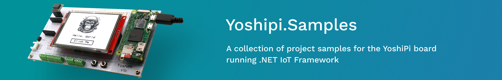
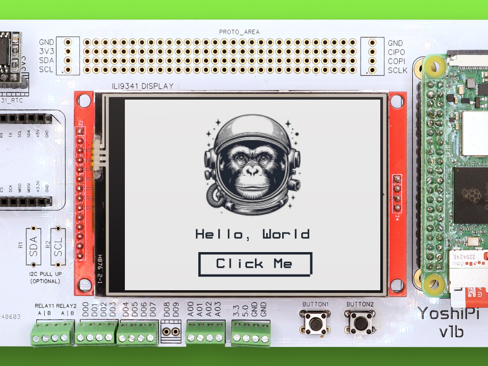
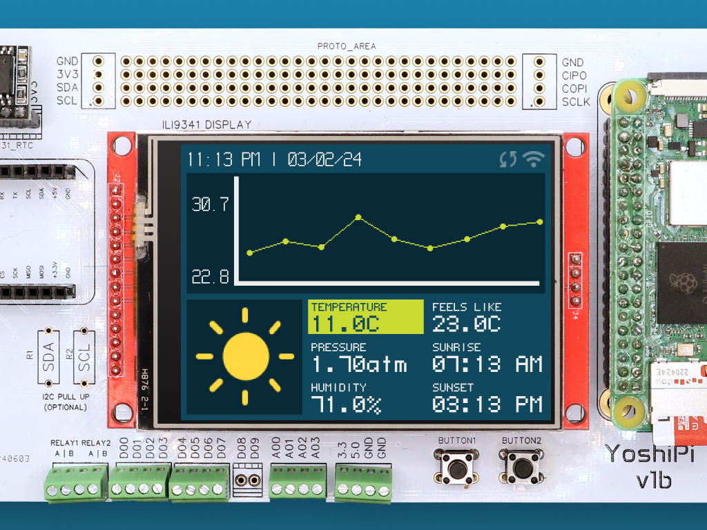
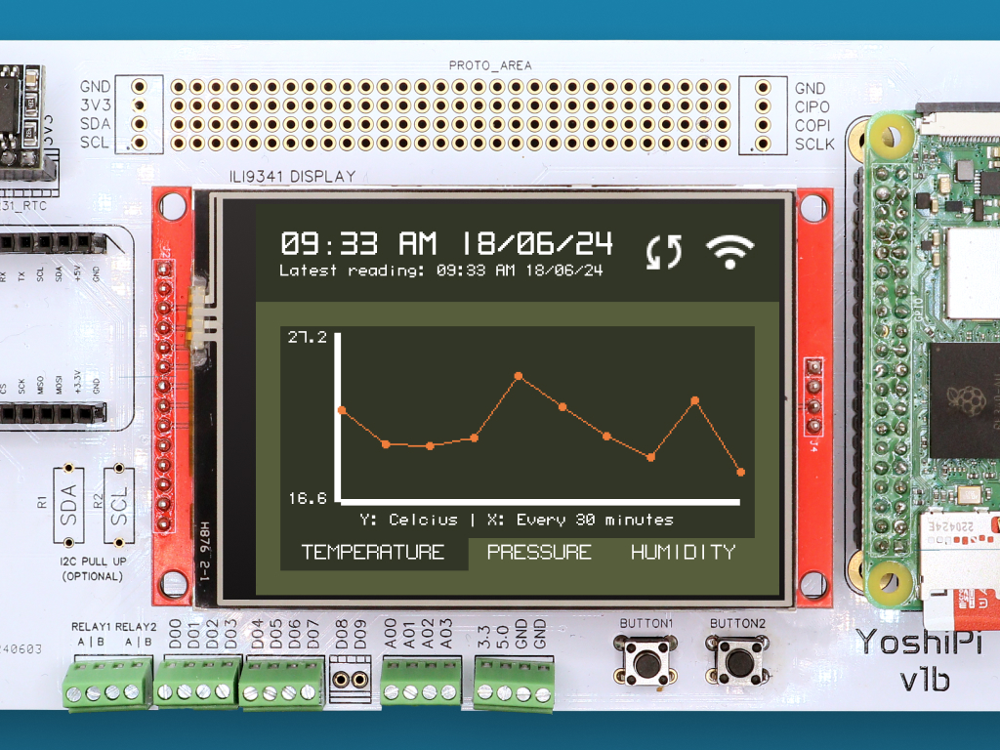
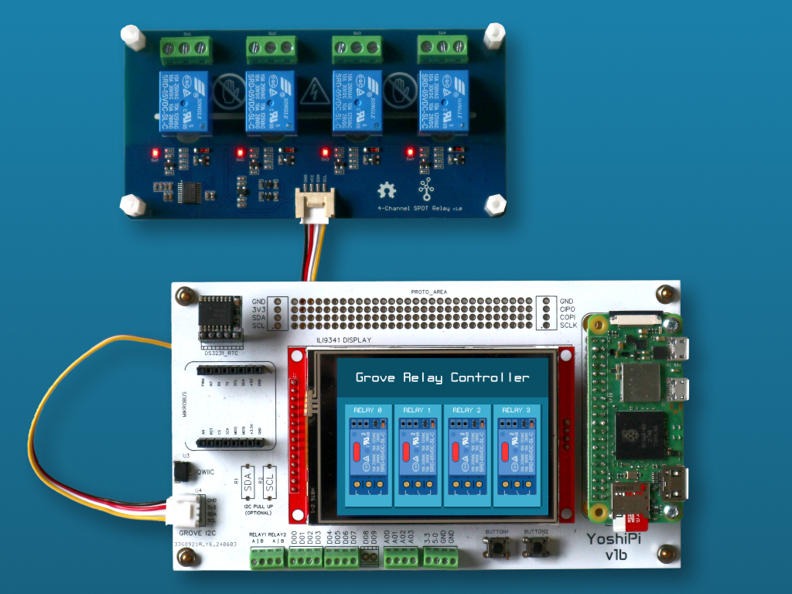
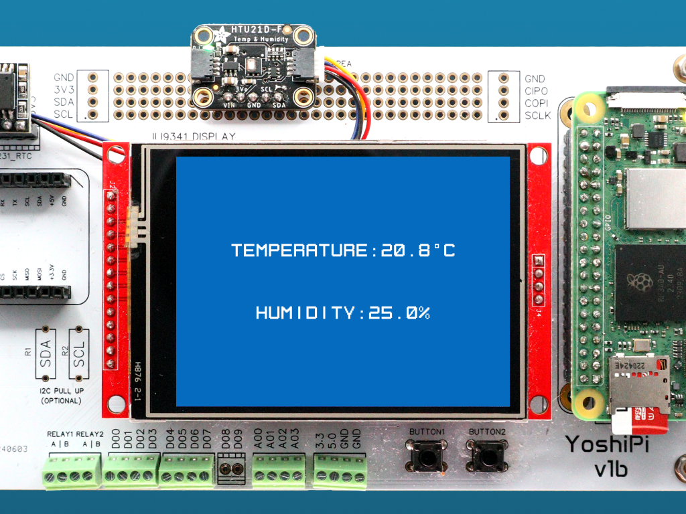

# Yoshipi.Samples

Project Samples:

<table>
    <tr>
        <td>
            <br/>
            Basic YoshiPi app with a touch-capable display</br> 
            <a href="Source/HelloYoshipi/">Source Code</a>
        </td>
        <td>
            <br/>
            Get weather forecast using FieldStack on a YoshiPi</br> 
            <a href="Source/WifiWeather/">Source Code</a>
        </td>
    </tr>
    <tr>
        <td>
            <br/>
            Send and graph environmental data with Azure IoT Hub</br>
            <a href="Source/AzureIoTHubLogging/">Source Code</a>
        </td>
        <td>
            <br/>
            Control a 4-channel relay on an interactive HMI with a touchscreen</br> 
            <a href="Source/GroveRelayController/">Source Code</a>
        </td>
    </tr>
    <tr>
        <td>
            <br/>
            Swap Simulated Temp/Humidity sensor to an HTU21D</br>
            <a href="Source/SensorsSample/">Source Code</a>
        </td>
        <td valign="top">
            <p>&nbsp;&nbsp;&nbsp;&nbsp;&nbsp;&nbsp;&nbsp;&nbsp;&nbsp;&nbsp;&nbsp;&nbsp;&nbsp;&nbsp;&nbsp;&nbsp;&nbsp;&nbsp;&nbsp;&nbsp;&nbsp;&nbsp;&nbsp;&nbsp;&nbsp;&nbsp;&nbsp;&nbsp;&nbsp;&nbsp;&nbsp;&nbsp;</p>
            Log and graph a tank's temperature with an MCP9601 thermocouple</br>
            <a href="Source/TankTemperatureMonitor/">Source Code</a>
        </td>
    </tr>
</table>

[](https://github.com/jorgedevs/Yoshipi.Samples/actions/workflows/build.yml) 

## Building

Samples reference [FieldStack](https://github.com/FieldStackIoT/FieldStack) by project path, so clone the two repositories side by side:

```
git clone https://github.com/FieldStackIoT/FieldStack
git clone https://github.com/jorgedevs/Yoshipi.Samples
```

Build everything:

```
dotnet build Source/Yoshipi.Samples.slnx -c Release
```

Publish one sample and copy the folder to the YoshiPi. Publish puts a `run` script beside the app; it sets `HOME=/data` and starts the app.

```
dotnet publish Source/HelloYoshipi -c Release -o publish
```

Each sample carries its own copy of the board support (display, buttons, touchscreen, relays, Qwiic) in its `YoshiPi.cs`.
